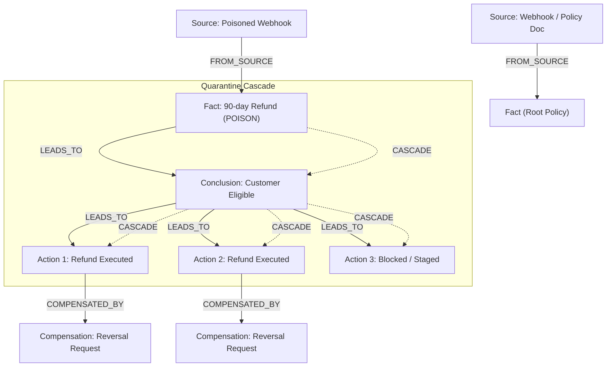

# Quorum: Git Revert for Agent Beliefs

> **Graph Hacks: Context for AI Agents** (WeMakeDevs x FalkorDB)  
> Track 02: Agent Memory and Coordination (~80% effort)  
> Track 03: Company Brain (~20% effort)

---

## Acceptance Focuses & Verification Pointers

### Track 02: Agent Memory and Coordination
| Focus | Feature Implementation | Where to Verify |
|---|---|---|
| **1. Episodic / Semantic / Procedural Memory** | Episodic (`Message` nodes + `source_ref`/`quote`), Semantic (`Fact`/`Conclusion`), Procedural (`Procedure` with ordered `steps[]`, `uses/successes/failures`). | Demo: Procedure selection changing between two runs based on score updates. `graph/queries.py` |
| **2. Persistent Conversation History** | Private raw graphs `Session -> Message` (NEXT-linked); session summary on close. Restarted agents resume via 2-query flow (raw then commons). | Demo: Agent restart beat with explicit attribution ("what I remember and where each belief came from"). |
| **3. Shared State and Handoffs** | `Handoff` nodes with atomic claim, lease, timeout recovery, `CONTEXT_ROOT` anchor. Exactly one winner under concurrent claims. | Demo: Visible claim race; `make proof` (100 handoffs x 30 claimers = 1 winner each). |
| **4. High-Concurrency Reads/Writes** | 30-agent harness with real throughput, p50/p95/p99 latencies, and zero-orphans invariant. | `bench/run.py` / `make proof` stdout and `bench/results.json`. |
| **5. Per-Tenant Memory & Updates** | Graph namespaces isolated via Redis ACL (`~tenant_<id>:*`); memory updates over time (SUPERSEDES, as-of, quarantine, restore). | `tests/test_tenant_isolation.py`; Live denied-read demo with tenant `globex`. |

### Track 03: Company Brain
| Focus | Feature Implementation | Where to Verify |
|---|---|---|
| **1. Docs, Tickets, Chats in One Graph** | Unified `Source` (DOC, TICKET, CHAT) -> `Fact` in commons graph from synthetic seed corpus (~25 items, 12 people, 4 teams, 3 projects, 3 systems). | Brain view in UI; `scripts/seed.py`. |
| **2. Who Owns What, Who Knows What** | `Team-[:OWNS]->Source`, `Person-[:AUTHORED\|RESOLVED]->Source-[:ABOUT]->Topic`. "Knows" = evidence count. | Brain Leaderboard view; `graph/queries.py::who_knows`. |
| **3. Tracing Decisions to Source** | Single causal query: `Decision <- LEADS_TO <- Fact -> Source` returning quote, URL, version, owner team. | Decision Trace inspector in UI; `graph/queries.py::provenance`. |
| **4. Keeping Knowledge Current** | `SUPERSEDES` by fact key, stale propagation (`stale=true`), REVIEW handoffs to owning teams. | Demo Step 4: Policy change flags dependent decisions stale and creates review handoffs. |
| **5. Answers with Clear Sources** | Grounded answers with citations, owner team, and freshness. Untraceable answers strictly refused. | `/api/brain/ask` endpoint; UI Ask box. |

---

## Pitch & The Problem

**Pitch:** Git revert for agent beliefs. Quorum rolls back a bad fact and everything built on it, and no later retrieval can return it.

**Problem:** Agents that share memory also share its errors. When one false belief enters shared context, downstream agents derive new conclusions and commit real-world side effects (issuing refunds, editing documentation, dispatching emails). Simply deleting the bad fact leaves corrupted conclusions and uncompensated actions behind.

**Quorum's Three Layers of Defense in FalkorDB:**
1. **PREVENT (Quorum Gate):** Irreversible actions that depend on uncorroborated leaf facts are blocked from automatic execution and escalated into a human REVIEW handoff.
2. **GUARD (Atomic Execute Guard):** An action cannot run unless every causal ancestor (`LEADS_TO`) and supporting fact (`SUPPORTS`) is verified currently `HEALTHY` in a single Cypher statement.
3. **REPAIR (Quarantine Cascade & Compensation):** When a belief is invalidated, a single cascade marks the entire downstream DAG `QUARANTINED`, hides it from retrieval, increments the context epoch, and enqueues compensating actions for real-world effects.



---

## Honest System Limits

- **Compensation is not undo:** Irreversible actions cannot be reversed automatically; they are flagged and escalated to human operators with drafted correction notices.
- **Context window latency:** An agent whose context window already contains a fact retains it until it rebuilds its context (triggered by an epoch change).
- **Claim boundary:** Quorum guarantees *no later retrieval returns quarantined content, and agents refresh stale windows*. It is NOT claimed that bad data never reached the model; in the demo scenario, Refunder executes 2 refunds before contradiction detection.
- **As-of queries:** Queries evaluating past belief states see the latest quarantine window per node.
- **Seeded procedure scores:** Baseline procedure scores are seeded in synthetic data.
- **Benchmark figures:** Benchmark numbers reported in docs and UI are the raw measured outputs of `bench/run.py`.
- **Property folding costs:** To keep graph traversals blazing fast, event streams and step arrays are folded into node properties (`Fact.source_ref`, `Fact.quote`, `quarantined_at`/`released_at`, `Procedure.steps[]`), saving edge overhead at the cost of history compaction.

---

## Verified Benchmark Results (`bench/run.py` / `make proof`)

The automated proof harness executes 4 rigorous stress tests on live FalkorDB:

| Benchmark / Invariant Test | Measured Result | Status |
|---|---|---|
| **30-Agent High Concurrency (70/30 read/write)** | **2,030.0 ops/sec** (p50: 12.6ms, p95: 23.1ms, p99: 28.9ms) | **PASSED** (0 orphan violations) |
| **Handoff Claim Race (100 handoffs x 30 claimers)** | **100.0%** clean claims (100/100 single winners, 0 multiple winners) | **PASSED** |
| **Atomic Execute-vs-Quarantine Race (50 actions)** | 1 executed pre-cascade, 49 refused post-cascade; 0 illegal executions | **PASSED** |
| **Poison Containment (Depth 1)** | **1.40 ms** to containment; **0.0%** retrieval leakage vs 100% baseline | **PASSED** |
| **Poison Containment (Depth 2)** | **1.62 ms** to containment; **0.0%** retrieval leakage vs 100% baseline | **PASSED** |
| **Poison Containment (Depth 3)** | **2.88 ms** to containment; **0.0%** retrieval leakage vs 100% baseline | **PASSED** |
| **Per-Tenant Redis ACL Isolation** | Unauthorized reads throw `NoPermissionError`; 0 cross-tenant graph reads | **PASSED** |

## Local Setup & Quickstart

### Prerequisites
- Docker & Docker Compose
- Python 3.11+

### Running the Stack
```bash
# Clone the repository
git clone https://github.com/janani26300427-tech/iFone.git
cd iFone

# Start FalkorDB, Mock Helpdesk, Backend, and Frontend
docker compose up -d

# Run the full automated verification & proof suite
make proof
```

---

## AI Assistant Disclosure
In compliance with the hackathon rules, AI assistants (Google Antigravity / Gemini) were used during development for design review, scaffolding, and test harness generation. All queries, architecture decisions, and code commits were reviewed, verified, and authored by the team members under their own identities.
